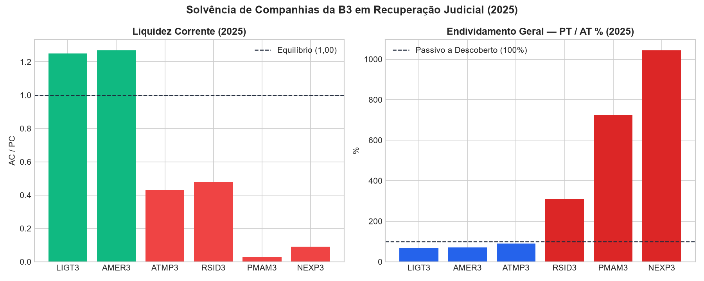
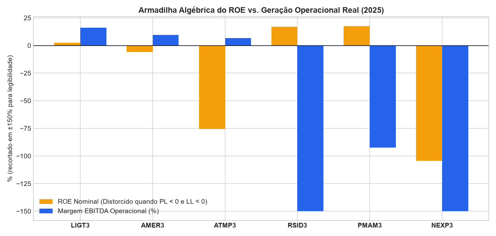

# Eficácia da Recuperação Judicial na Reestruturação Financeira de Companhias da B3 (2022–2025)


Estudo longitudinal e auditoria quantitativa de Demonstrações Financeiras (Balanço Patrimonial e DRE, 2022–2025) de **6 companhias abertas listadas na B3** submetidas à Recuperação Judicial (Lei nº 11.101/2005 e Lei nº 14.112/2020): **`ATMP3`**, **`RSID3`**, **`PMAM3`**, **`AMER3`**, **`NEXP3`** e **`LIGT3`**.

---

## Principais Achados Empíricos

1. **Dicotomia entre Alívio Contábil e Recuperação Operacional:** A homologação de planos com deságio (*haircut*) ou conversão de dívida gera ganhos financeiros não recorrentes pontuais no Lucro Líquido (ex.: `AMER3` em 2024), mas apenas a sustentabilidade do **EBITDA / Margem EBITDA** e do **Capital Circulante Líquido (CCL)** comprova reestruturação efetiva (destaque para **`LIGT3`** com $\\text{LC} = 1{,}25$ e Margem EBITDA de `16,10%` em 2025).
2. **Detecção Algébrica de Falso Positivo no ROE:** Empresas com **Passivo a Descoberto ($\text{PL} < 0$)** que apuram **Prejuízo Líquido ($\text{LL} < 0$)** produzem matematicamente um **ROE positivo artificial** ($\\frac{-}{-} = +$), detectado automaticamente em `RSID3`, `PMAM3`, `ATMP3` e `NEXP3`.
3. **Erosão Extrema de Capital de Giro:** Companhias que ingressam tardiamente em RJ apresentam deterioração crítica (`PMAM3` caiu para $\\text{LC} = 0{,}03$ e `Endividamento Geral = 723,14%` em 2025; `NEXP3` atingiu `1.044,50%`).

---

## Estrutura do Repositório

```text
├── assets/
│   ├── liquidez_vs_endividamento.png
│   ├── roe_falso_positivo_vs_ebitda.png
│   └── trajetoria_liquidez_b3.png
├── data/
│   └── base_consolidada_rj_b3.csv        # Dados contábeis públicos consolidados (2022–2025)
├── docs/
│   └── diagnostico_indicadores_rj.md     # Tabelas analíticas e fórmulas detalhadas
├── src/
│   └── analise_rj_b3.py                  # Pipeline Python de validação contábil e gráficos
├── requirements.txt
└── LICENSE
```

---

## Como Executar Localmente (< 1 minuto)

```bash
pip install -r requirements.txt
python src/analise_rj_b3.py
```

Os indicadores validados são exportados para `outputs/resumo_indicadores_validados.csv` e os gráficos são gerados em `assets/`.

## Visualizações Geradas




---

**Autor:** [Jonathan Campos Cusandei](https://www.linkedin.com/in/jonathancusandei/) · [Portfólio Executivo](https://jonathancusandei-glitch.github.io/portfolio-jonathan/)
